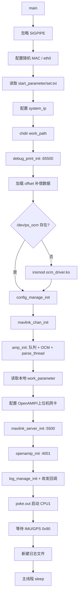
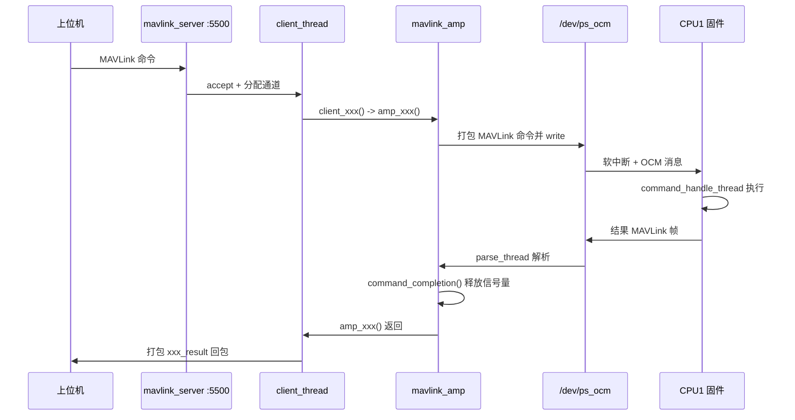
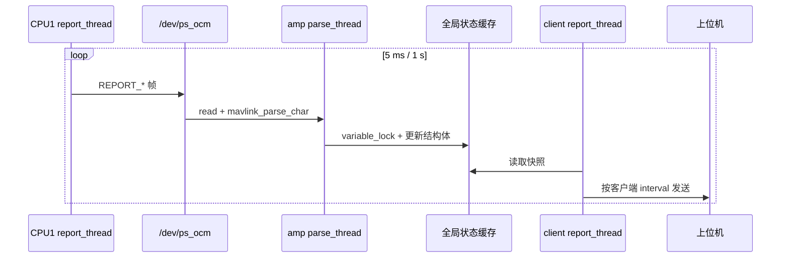
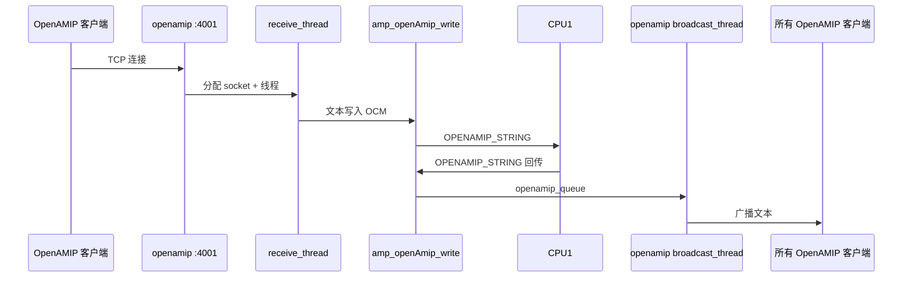

# amp_app

运行在 Zynq-7000 **CPU0 Linux 用户态**的 AMP 应用，负责把“上位机/OpenAMIP 网络”与“CPU1 对星固件”连接起来，同时管理启动参数、天线配置、日志和固件文件。

> CPU1 固件见本仓库 `embedded_software_cplus_leo` 分支。本分支只包含 Linux 应用的 `src/`。

---

## 1. 定位与系统边界

| 侧 | 组件 | 职责 |
|---|---|---|
| CPU0 | Linux + `amp_app` | 网络接入、配置管理、日志、固件文件管理、OCM 消息桥接 |
| CPU1 | `embedded_software_cplus_leo` | 对星状态机、天线/变频器/信标机驱动、设备监控 |
| 核间 | `/dev/ps_ocm` + 软中断 | 双向 MAVLink 帧传输 |

`amp_app` 本身**不做**对星计算，也不直接控制天线；它把上位机命令转成 MAVLink 帧写入 OCM，等待 CPU1 返回结果，再把结果回给上位机。同时把 CPU1 周期上报的遥测缓存下来，按客户端配置的周期转发。

主要对外接口：

| 接口 | 默认端口 | 用途 |
|---|---|---|
| 上位机 TCP | `5500` | MAVLink 命令/遥测 |
| OpenAMIP TCP | `4001` | OpenAMIP 字符串双向透传 |
| 调试 TCP | `65500` | 本地 `LOG_*` 文本输出 |
| OCM | `/dev/ps_ocm` | 与 CPU1 的 MAVLink 通道 |

---

## 2. 启动流程

入口为 `main(int argc, char *argv[])`。

### 2.1 参数

```text
./AMP_APP.elf <start_parameter_dir> [restart]
```

- `argv[1]`：启动参数目录，默认 `/home/root/XPHASED/start_parameter/`。
- `argv[2]`：可选。等于 `restart` 时跳过交叉极化补偿数据加载。

### 2.2 启动顺序

| 步骤 | 动作 | 说明 |
|---|---|---|
| 1 | 忽略 `SIGPIPE` | 防止客户端断开导致进程退出 |
| 2 | 随机生成 MAC 并配置 `eth0` | `ifconfig eth0 down` → 设置 MAC → `up` |
| 3 | `start_parameter_init()` | 读取启动参数目录下的 `set.txt` |
| 4 | 配置系统 IP | `ifconfig eth0 <system_ip> netmask <system_mask> up` |
| 5 | `chdir(work_path)` | 默认 `/home/root/`，之后的相对路径都基于此 |
| 6 | `debug_print_init(log_path, 65500)` | 调试文本落盘 + TCP 调试服务 |
| 7 | 加载交叉极化补偿数据 | 写入 `/dev/mem` 的 `offset_load_address`，并记录校验信息 |
| 8 | 检查/加载 OCM 驱动 | `/dev/ps_ocm` 不存在时执行 `insmod ocm_driver.ko` |
| 9 | `config_manage_init(config_path)` | 读取 `antenna_config/set.txt` |
| 10 | `mavlink_chan_init()` | 初始化 MAVLink 通道池和读写锁 |
| 11 | `amp_init(ocm_device_name)` | 创建命令原语、POSIX 消息队列、打开 OCM、启动解析线程 |
| 12 | `amp_get_work_parameter()` | 从**本地配置**读取工作参数（不是向 CPU1 请求） |
| 13 | 配置 OpenAMIP / 上位机网卡 | 按需创建 `eth0:0`、`eth0:1` 并设置 IP |
| 14 | `mavlink_server_init(servicer_port)` | 启动上位机 TCP 服务（默认 5500） |
| 15 | `openamip_init(openamip_port)` | 启动 OpenAMIP TCP 服务（默认 4001） |
| 16 | `log_manage_init(log_path)` | 创建 `.hex` 日志目录、写线程、清理线程 |
| 17 | `amp_set_transmit_callbk()` | 把 OCM 通道的收/发回调接到日志模块 |
| 18 | 启动 CPU1 | `./poke.out 0xfffffff0 <firmware_load_addrss>` |
| 19 | 等待 GPS/授时就绪 | 轮询 `amp_read_imu_state()`，直到 `state & 0x90 == 0x90` |
| 20 | `log_manage_new_file()` | 用有效 GPS 时间创建新的日志文件 |
| 21 | 主线程休眠 | `while(1) sleep(30);`，业务都在后台线程 |



> **启动依赖**：`amp_init` 必须在 `config_manage_init` 之后、`mavlink_server_init` 之前完成；`log_manage_init` 必须在 `amp_set_transmit_callbk` 之前完成，否则早期 OCM 流量不会进入 `.hex` 日志。

---

## 3. 目录结构

```text
src/
├── main.c                  进程入口与启动编排
├── start_parameter/        启动参数（目录 + set.txt 解析 + 默认值）
├── set/                    通用 key="value" 配置文件读写
├── config_manage/          天线业务配置（跟踪/工作/波束/零漂/产品信息）
├── mavlink/                SATMOV_v2 MAVLink 生成代码
├── mavlink_amp/            OCM 命令桥接核心（amp_* 接口、命令同步、OCM 解析线程）
├── mavlink_chan/           MAVLink 通道池（fd/socket/virtual + 读写锁 + 回调）
├── mavlink_socket/         上位机 TCP 服务端、客户端线程、遥测上报
├── openamip/               OpenAMIP TCP 服务端、客户端接收、广播
├── log_manage/             OCM 原始帧 .hex 日志（30 MB 轮转 / 600 MB 清理）
├── debug_manage/           本地调试文本日志 + TCP 调试服务（5 MB / 60 MB）
├── offset_load/            交叉极化补偿数据写入 /dev/mem
└── mavlink_amp/mavlink_amp.c  约 2800 行，命令与上报的核心
```

---

## 4. 线程模型

| 线程 | 创建位置 | 作用 |
|---|---|---|
| `main` | 进程入口 | 只做启动编排，最后休眠 |
| `parse_thread` | `amp_init()` | 阻塞读 `/dev/ps_ocm`，解析 CPU1 发来的 MAVLink |
| `tcp_server_thread` | `mavlink_server_init()` | `accept` 上位机连接 |
| `client_thread` | `mavlink_create_client()` | 每个上位机连接一个，解析命令并调用 `amp_*` |
| `report_thread` | `client_thread` 内 | 每个客户端一个，按配置周期发送遥测 |
| `broadcast_thread` | `mavlink_client_init()` | 从广播队列取消息，发给所有上位机客户端 |
| `tcp_server_thread` | `openamip_init()` | `accept` OpenAMIP 连接 |
| `receive_thread` | OpenAMIP 每客户端 | 读 OpenAMIP 字符串，写入 CPU1 |
| `broadcast_thread` | `openamip_init()` | 从 `openamip_queue` 取字符串，广播给所有 OpenAMIP 客户端 |
| `save_thread` | `log_manage_init()` | 把 `.hex` 日志写入文件 |
| `clear_thread` | `log_manage_init()` | 每 10 s 检查日志总大小并删除最旧文件 |
| `save_thread` | `debug_print_init()` | 把调试文本写入 `.txt` |
| `clear_thread` | `debug_print_init()` | 每 10 s 清理超过 60 MB 的调试日志 |
| `tcp_server_thread` | `debug_print_init()` | 调试 TCP 服务，`poll` 多客户端 |

`.hex` 与 `.txt` 的 `save_thread` 都是“管道 + 单写线程”，避免多线程直接写文件。

---

## 5. 三条数据通路

### 5.1 上位机命令



- 每个命令有独立的 `pthread_mutex_t` + `sem_t`（`command_common_t`）。
- 调用方 `command_lock()` → 发送 → `command_wait(1000 ms)` → `command_unlock()`。
- `parse_thread` 收到对应的 `*_RESULT` 后调用 `command_completion()`，唤醒等待者。
- 多个客户端同时发同一类命令时，会被该命令的互斥量串行化；不同命令可并行。

### 5.2 周期遥测



- CPU1 默认：IMU/天线/信标 5 ms，变频器/整机 1000 ms。
- 上位机客户端默认：IMU/天线/信标 5 ms，变频器/整机/卫星 100 ms。
- 每个客户端可用 `SET_REPORT` 单独修改上报周期。

### 5.3 OpenAMIP



- 新连接建立时，`receive_thread` 先发 `new connect\n` 给 CPU1。
- 单条字符串上限 200 字节（`amp_openAmip_write` 截断）。
- OpenAMIP 与上位机 MAVLink 是两套独立 TCP 服务，互不占用端口。

### 5.4 日志与调试

- **协议日志**：`amp_set_transmit_callbk()` 把 OCM 通道每次 `read/write` 的原始字节交给 `log_manage`，按 `AA | type | len | payload | 55` 写入 `.hex`。
- **本地调试**：`LOG_*` 宏经 `debug_print` 写入 `.txt`，并通过 TCP `65500` 实时输出。
- **CPU1 日志**：CPU1 的 `LOG_STRING` 经 OCM 到 `parse_thread`，进入广播队列，最终发给所有上位机客户端。

---

## 6. 命令桥接机制（`mavlink_amp.c`）

### 6.1 `amp_init()`

1. 初始化 24 个命令的 `command_common_t`（互斥量 + 信号量）。
2. 初始化全局变量锁 `variable_mutex`。
3. 创建 12 个 POSIX 消息队列：
   - 自检结果、版本、22B/286B 透传、信标/变频器透传；
   - OpenAMIP 字符串、日志字符串、校准完成；
   - 广播队列（容量 128 条 `mavlink_message_t`）。
4. 打开 `/dev/ps_ocm`，分配 MAVLink 通道（`NORMAL_FD`）。
5. 创建并 detach `parse_thread`。

### 6.2 命令分类

| 类别 | 代表命令 | 处理位置 |
|---|---|---|
| 通用 | `CORRECT_IMU`、`RESTART`、`READ_VERSION`、`SWITCH_ANTENNA`、`SET_REPORT`、`SET_BEACON`、`SET_TRANSDUCER`、`SET_BEAM_POINT`、`SELF_CHECK`、`START/STOP_TRACKING`、`SET_MONITOR` | 部分本地执行，部分转发 CPU1 |
| 高轨 | `REQUEST/SET BEAM_PARAMETER`、`TRACKING_PARAMETER`、`WORK_PARAMETER`、`UPDATE_TLE`、`SWITCH_IMU_HARDWARE`、`NEW_TRANSDUCER` | 本地配置 + CPU1 执行 |
| 低轨 | `CURRECT_YAW`、`ISSUE_EARTH_POINT`、`SAVE/CLEAR_EARTH_POINT` | 转发 CPU1 |
| 透传 | `PASSTHROUGH_22B_PACK`、`PASSTHROUGH_286B_PACK`、`BEACON_PACK`、`TRANSDUCER_PACK` | 转发 CPU1 |
| 上报 | `REPORT_BEACON/IMU/ANTENNA/TRANSDUCER/MACHINE/SATELLITE_STATE` | CPU1 -> 缓存 -> 客户端 |

### 6.3 本地执行 vs 转发 CPU1

- **本地执行**
  - `amp_reboot(0x01)`：`exit(0)` 重启 APP；
  - `amp_reboot(0x03)`：`sync` + `reboot -n` 重启系统；
  - `amp_update_firmware(0x00)`：复制 APP 到 `./AMP_APP.elf`；
  - `amp_update_firmware(0x01/0x02/0x03)`：复制到 `/mnt/<antenna_name>.bin.CLC/.OLC/.test`；
  - `amp_switch_firmware()`：把选中的固件复制为 `/mnt/firmware.bin`；
  - `amp_get_*_parameter()`：直接读本地 `antenna_config`。
- **转发 CPU1**
  - 零漂校准、天线开关、波束指向、信标/变频器设置、跟踪启停、自检、低轨校准/地理指向等。

> `amp_app` 只负责准备固件文件并把 CPU1 入口地址写入 `0xfffffff0` 后唤醒；镜像实际如何放到 DDR，由启动脚本/引导程序决定。

---

## 7. 配置管理

### 7.1 启动参数目录

`start_parameter_init()` 把目录交给 `set_init()`，读取其中的 `set.txt`。文件格式：

```text
key="system_ip",type="str",data="192.168.0.254",desc="系统IP"
key="servicer_port",type="u16",data="5500",desc="上位机端口"
...
file end!!
```

支持类型：`f64/f32/i8/i16/i32/u8/u16/u32/str`。

启动参数键（`start_parameter.h`）：

| 键 | 类型 | 默认值 | 用途 |
|---|---|---|---|
| `offset_load_address` | u32 | `0x20000000` | 补偿数据写入 `/dev/mem` 的地址 |
| `offset_file_name` | str | `/usr/xphasedApp/VU5555.bin` | 补偿数据文件；`none` 表示不加载 |
| `firmware_load_addrss` | u32 | `0x38000000` | CPU1 入口/镜像地址 |
| `ocm_device_name` | str | `/dev/ps_ocm` | OCM 设备节点 |
| `config_path` | str | `./antenna_config` | 业务配置目录（相对 `work_path`） |
| `log_path` | str | `./antenna_log` | `.hex` 日志目录 |
| `upper_computer_network_card` | str | `eth0:1` | 上位机网卡别名 |
| `OpenAMIP_network_card` | str | `eth0:0` | OpenAMIP 网卡别名 |
| `work_path` | str | `/home/root/` | 工作目录 |
| `system_ip` | str | `192.168.0.254` | 系统 IP |
| `system_mask` | str | `255.255.255.0` | 系统掩码 |

### 7.2 业务配置

`config_manage_init(config_path)` 读取 `antenna_config/set.txt`，管理五类参数：

| 结构 | 内容 | 默认值来源 |
|---|---|---|
| `tracking_info_t` | 波束宽度、DVB/检波/信标粗精跟踪阈值、KP、驻留系数、跟踪偏角 | `DEFAULT_TRACKING_PARAMETER` |
| `work_info_t` | 工作模式、OpenAMIP/上位机 IP/端口、rolloff、跟踪模式、手动 GPS | `DEFAULT_WORK_MODE` |
| `beam_info_t` | 卫星经度/名称、收发频率/极化/本振/增益、符号率、捕获范围 | `DEFAULT_BEAM_INFO` |
| `imu_drift_t` | 零漂有效标志、三轴零漂 | `DEFAULT_IMU_DRIFT` |
| `product_info_t` | 天线名称、天线序列号 | `DEFAULT_PRODUCT_INFO` |

读取失败时使用默认值；`config_manage_set_*` 会通过 `set_sync()` 写回 `set.txt`。

### 7.3 网络配置逻辑

- `eth0` 使用 `system_ip/system_mask`。
- OpenAMIP IP/掩码与系统不同：创建 `openAMIP_net`（默认 `eth0:0`）。
- 上位机 IP/掩码与系统、OpenAMIP 都不同：创建 `upper_net`（默认 `eth0:1`）。

---

## 8. 日志与调试

### 8.1 协议日志（`.hex`）

- 目录：`log_path`，默认 `./antenna_log`。
- 文件名：由 GPS 周/秒换算的本地时间，格式 `YY-MM-DD;HH.MM.SS.hex`。
- 帧格式：`0xAA | 方向(1B) | 长度(2B) | 载荷 | 0x55`，方向 `0x00` Linux→固件，`0x01` 固件→Linux。
- 单文件超过 **30 MB** 自动新建；目录总大小超过 **600 MB** 删除最旧文件。
- 无有效 GPS 时使用上次记录的时间（`log_gps_time.dat`）递增，保证文件名不冲突。

### 8.2 调试日志（`.txt` + TCP）

- 目录：`log_path`，文件名同样基于 GPS 时间。
- 单文件超过 **5 MB** 轮转；目录总大小超过 **60 MB** 删除最旧文件。
- TCP 调试端口 **65500**，`poll` 支持多客户端，只输出不接收命令。
- 调试等级由各模块的 `DEBUG_LEVEL` 决定，可在 `debug_print_set_level()` 调整全局等级。

### 8.3 日志时序注意

`amp_set_transmit_callbk()` 在 `log_manage_init()` 之后调用，因此：

- `amp_init()` 初始化阶段的少量 OCM 交互不会进入 `.hex`；
- 从 `amp_set_transmit_callbk()` 之后开始完整记录命令/遥测原始帧。

---

## 9. OCM 与 CPU1 固件

### 9.1 设备与驱动

- 内核模块：`ocm_driver.ko`
- 设备节点：`/dev/ps_ocm`
- `main()` 在节点不存在时尝试 `insmod ocm_driver.ko`；仍失败则 `amp_init()` 打开失败，进程退出。

### 9.2 消息机制

- 与 CPU1 侧 `ps_ocm.c` 对应，双向各一块 1024 字节消息区。
- `amp_app` 把 MAVLink 帧作为字节流 `write()` 到 `/dev/ps_ocm`，内核驱动通过软中断通知 CPU1。
- CPU1 回传同样通过 OCM，`amp parse_thread` 阻塞 `read()` 后逐字节解析。

### 9.3 启动 CPU1

```text
./poke.out 0xfffffff0 <firmware_load_addrss>
```

- 默认地址 `0x38000000`，与 CPU1 `lscript.ld` 的 `ps7_ddr_0` 起始一致。
- 该命令只写入口地址并触发唤醒；CPU1 镜像需已由启动流程放到对应 DDR 地址。

---

## 10. 构建与运行

### 10.1 构建环境

- Xilinx SDK/Vitis **2018.3**（工程元数据为 `Created by SDK v2018.3`）。
- 工具链：Xilinx ARM v7 GNU/Linux Toolchain。
- 链接库：`-lrt`（POSIX mqueue）、`-lpthread`。
- 本分支只包含 `src/`，`*.cproject`、`*.project` 未纳入仓库；需要在 SDK/Vitis 中新建 Linux Application Project，把 `src/` 加入源码目录。
- 生成产物：`AMP_APP.elf`。

### 10.2 运行时文件布局

```text
/home/root/
├── AMP_APP.elf
├── poke.out
├── ocm_driver.ko
├── antenna_config/
│   └── set.txt
├── antenna_log/            # 运行后自动创建
├── start_parameter/
│   └── set.txt
└── ...

/mnt/
├── firmware.bin            # 当前选中的 CPU1 固件
├── <antenna_name>.bin.CLC  # 高轨固件
├── <antenna_name>.bin.OLC  # 低轨固件
└── <antenna_name>.bin.test # 暗室测试固件
```

### 10.3 运行

```bash
chmod +x AMP_APP.elf poke.out
./AMP_APP.elf /home/root/XPHASED/start_parameter
```

重启场景（跳过补偿数据加载）：

```bash
./AMP_APP.elf /home/root/XPHASED/start_parameter restart
```

### 10.4 端口与连接

| 端口 | 服务 | 连接方 |
|---|---|---|
| 5500 | 上位机 MAVLink | 上位机/测试工具 |
| 4001 | OpenAMIP | 调制解调器/OpenAMIP 客户端 |
| 65500 | 调试文本 | 调试终端 |

---

## 11. 常见问题定位

| 现象 | 优先检查 |
|---|---|
| `amp init failed` / `open ocm driver file failed` | `/dev/ps_ocm` 是否存在、`ocm_driver.ko` 是否加载 |
| CPU1 无响应、无遥测 | `poke.out` 是否执行、`firmware_load_addrss` 是否正确、CPU1 镜像是否在 DDR |
| 一直不创建新 `.hex` | `amp_read_imu_state()` 的 `state & 0x90` 是否就绪（GPS/授时） |
| 上位机连不上 | `system_ip`、`servicer_port`、防火墙/网卡别名 |
| OpenAMIP 连不上 | `openamip_port`、`eth0:0`、OpenAMIP 客户端是否发送了数据 |
| 配置不生效 | 是否在 `work_path` 下找到了 `antenna_config/set.txt`，格式是否以 `file end!!` 结束 |
| 命令超时 | CPU1 是否卡在初始化 22 s 内、对应 `*_RESULT` 是否被 `parse_thread` 收到 |
| 日志时间不对 | GPS 是否有效、`log_gps_time.dat` 是否可写 |
| 进程重启后行为异常 | POSIX mqueue 是否残留（`/dev/mqueue`），必要时清理后重启 |

---

## 12. 阅读顺序建议

1. `main.c`：先看清启动顺序和依赖。
2. `mavlink_amp.c` 的 `amp_init()`、`parse_thread()`、`amp_xxx()`：命令如何过 OCM。
3. `mavlink_socket/mavlink_client.c`：上位机命令如何进入 `amp_xxx()`、结果如何回包。
4. `openamip/openamip.c`：OpenAMIP 文本如何双向透传。
5. `config_manage/` 与 `start_parameter/`：参数从哪里来、默认值是什么。
6. `log_manage/` 与 `debug_manage/`：日志格式、轮转、清理策略。
