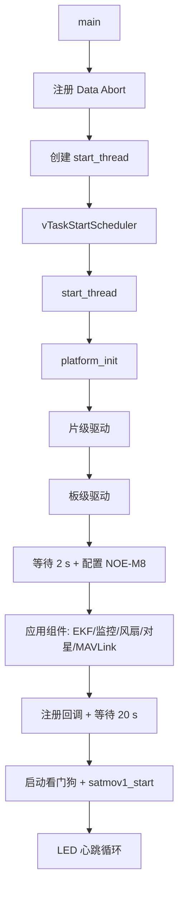
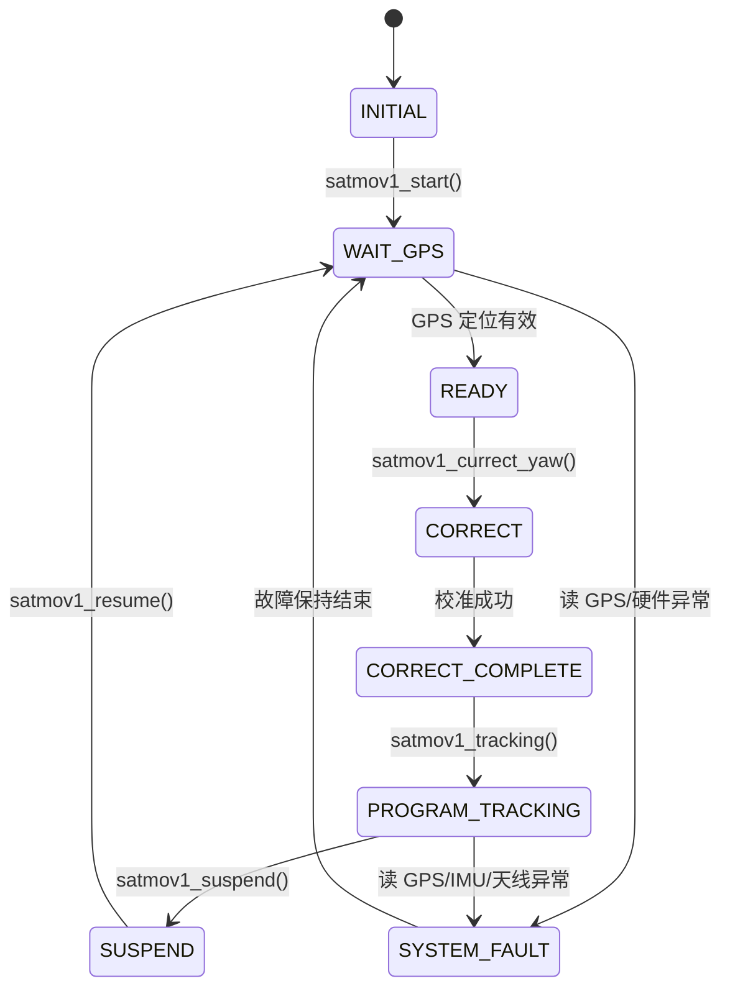

# embedded_software_cplus_leo

Zynq-7000 **CPU1 裸机固件**，基于 FreeRTOS，负责：

- 对星/跟踪状态机与天线指向控制
- 板级设备驱动（电源、变频器、信标机、天线阵面、NOE-M8、ADIS16465 等）
- 设备健康监控、故障码汇总、风扇控制
- 与 Linux 端 `amp_app` 之间的 MAVLink-over-OCM 通信

> Linux 端配套程序见本仓库 `amp_app` 分支。本分支只包含 CPU1 固件的 `src/`。

---

## 1. 运行位置与启动链

| 核 | 运行内容 | 关键点 |
|---|---|---|
| CPU0 | Linux + `amp_app` | 负责网络、配置、日志、上位机/OpenAMIP 接入 |
| CPU1 | 本固件 | FreeRTOS，裸机运行，不跑 Linux |

启动链路：

```text
FSBL -> U-Boot -> Linux -> amp_app
                              |
                              | poke.out 0xfffffff0 <firmware_load_addrss>
                              v
                         CPU1 从入口地址开始执行本固件
```

- `lscript.ld` 将代码链接到 DDR `0x38000000`（`ps7_ddr_0`）。
- Linux 端把 CPU1 入口地址写入 `0xfffffff0` 并执行 `SEV` 唤醒 CPU1。
- 当前 `driver_config.h` 打开的是 `USING_CORE1`，因此本固件**不会**自己启动 CPU1；`start_cpu1()` 仅在 `USING_CORE0` 编译时存在。

---

## 2. 启动流程

### 2.1 `main()`

1. 注册 Data Abort 异常处理函数。
2. 创建 `start_thread`（优先级 `tskIDLE_PRIORITY + 2`）。
3. 调用 `vTaskStartScheduler()` 启动 FreeRTOS 调度器。

### 2.2 `start_thread()`

1. 打印编译日期/时间。
2. 调用 `platform_init()` 完成全部初始化。
3. 进入 LED 心跳循环：
   - 全局故障码为 0：绿灯闪；
   - 有故障：红灯闪；
   - 亮/灭各 800 ms。
4. 若 `DEBUG_LEVEL == DEBUG_OUTPUT`，额外打印所有任务的状态、栈水位、运行时间和剩余堆。

### 2.3 `platform_init()` 初始化顺序

| 阶段 | 内容 | 说明 |
|---|---|---|
| 1. 片级驱动 | `ps_gpio`、`axi_gpio`、`ps_ocm`、`axi_dma`、`axi_uartlite`、`axi_uart550`、`ps_i2c`、`axi_pwm`、`axi_capture`、`ps_wdt`、`ps_spi` | 由 `driver_config.h` 的 `USING_*` 宏裁剪 |
| 2. 板级驱动 | `power`、`rav260`（可选）、`transducer`、`beacon`、`antenna`、`tmp112`、`ina220/ina226`、`adis16465`、`noe_m8` | 设备注册后可通过名字打开 |
| 3. 上电等待 | `vTaskDelay(2000)` | 等待外设电源稳定 |
| 4. NOE-M8 配置 | 打开 `noe_m8_0`，调用 `noe_m8_produce_cfg()` | 写入默认 GNSS/INS 配置 |
| 5. 应用组件 | `adis16465_imu1_init()`、`device_monitor_init()`、`fan_control_init()`、`satmov1_init()`、`mavlink_top_init()` | 创建业务任务/通道 |
| 6. 日志重定向 | `debug_print_custom_set(mavlink_print)` | CPU1 日志改走 MAVLink 上报 |
| 7. 回调注册 | 变频器/信标机透传回调、天线广播回调、校准完成回调 | 硬件事件转为 MAVLink 广播 |
| 8. 稳定等待 | `vTaskDelay(20000)` | 等待传感器/射频通道稳定 |
| 9. 看门狗 | `ps_wdt_start()` | 初始化完成后才启动 |
| 10. 启动对星 | `satmov1_start()` | 状态机进入等待 GPS |

> **注意**：从上电到 `satmov1_start()` 大约需要 **22 秒**（2 s + 20 s）。Linux 端在等待 GPS 就绪时也会相应等待。



---

## 3. 目录结构

```text
src/
├── main.c                  入口、start_thread、异常处理
├── platform.c/.h           平台初始化总入口
├── lscript.ld              Cortex-A9 链接脚本（0x38000000）
├── driver/
│   ├── core/               设备模型、FIFO、滤波器、调试、链表
│   ├── chip/               Zynq 片内 IP 驱动（GPIO/OCM/DMA/UART/I2C/SPI/PWM/Capture/WDT）
│   ├── board/              板级器件（电源、天线、信标机、变频器、NOE-M8、ADIS16465、INA、TMP112）
│   └── driver_config.h     功能裁剪、设备参数、版本号
├── misc/
│   ├── device_monitor.c    周期采样温度/电压/电流，生成故障码
│   └── fan_control.c       PWM 风扇 + 转速捕获
├── satmov/
│   ├── satmov_tracking.c   对星状态机（与硬件无关）
│   ├── satmov_port.c       状态机到具体硬件的适配层
│   └── satmov_common.c     地理/载体坐标、极化、姿态预测计算
├── tr_arhs/                ADIS16465 + EKF2 + uORB（C++）
├── user-interface/
│   ├── mavlink_chan.c      MAVLink 通道抽象与读写锁
│   ├── mavlink_remote.c    命令解析/分发、周期上报、广播
│   └── mavlink_top.c       创建 OCM 通道（可选串口通道）
└── unit-test/              各外设的点灯/回环测试，仅在 bring-up 时单独调用
```

---

## 4. 设备模型

`driver/core/device.c` 实现了一套轻量级字符设备抽象：

- 每个驱动定义静态 `device_t`，通过 `device_register()` 注册到全局链表。
- 上层统一使用：
  - `device_open(name, oflag)` / `device_close()`
  - `device_read()` / `device_write()` / `device_pread()` / `device_pwrite()`
  - `device_ctrl()`（超时、消息大小等）
- 每个设备自带互斥锁、引用计数、接收超时和收发 FIFO。
- 驱动通过 `struct device_ops` 提供 `init/open/release/pread/pwrite/control`。

常用设备名：

| 设备名 | 驱动 | 用途 |
|---|---|---|
| `ps_ocm` | `ps_ocm.c` | 与 CPU0 的核间通信 |
| `axi_dma0` | `axi_dma.c` | 天线阵面高速串行数据 |
| `axi_uart0/1/2/3/4` | `axi_uartlite.c`、`axi_uart550.c` | 变频器、信标机、NOE-M8、调试串口 |
| `ps_i2c0/1` | `ps_i2c.c` | TMP112、INA220/INA226 |
| `ps_spi0` | `ps_spi.c` | ADIS16465 |
| `noe_m8_0` | `noe_m8.c` | GNSS/INS 组合导航 |
| `transducer0` | `transducer.c` | 上下变频器 |
| `beacon0` | `beacon.c` | 信标/多模机 |
| `adis16465_0` | `adis16465.c` | 外部 IMU |
| `tmp112_0`、`ina226_0`、`ina220_1` | 对应驱动 | 温度/电压/电流监测 |

`driver_config.h` 是唯一的硬件裁剪入口：打开/关闭 `USING_*` 宏即可增减驱动；`POWER_INFO`、`*_CONFIG` 定义设备参数和电源网络。

---

## 5. 任务与优先级

| 任务 | 优先级 | 周期/行为 | 作用 |
|---|---|---|---|
| `start_thread` | idle + 2 | 800 ms | 平台初始化、LED 心跳 |
| `satmove_thread` | `configMAX_PRIORITIES - 3` | 1 s | 对星状态机主循环 |
| `monitor_thread` | idle + 2 | 100 ms（`LFP_SAMPLING_PERIOD`） | 温度/电压/电流采样、故障码 |
| `control_thread`（风扇） | idle + 3 | 500 ms | PWM 调速、转速捕获 |
| `ADIS16465_main` | idle + 6 | 传感器节拍 | 读取 ADIS16465 |
| `ekf2_main` | idle + 6 | EKF 节拍 | EKF2 姿态解算 |
| `Vehivle_EKF_OUT` | idle + 5 | 输出节拍 | 发布/读取 EKF 姿态 |
| `parse_thread` | `configMAX_PRIORITIES - 4` | 阻塞读 OCM | 解析 MAVLink 字节流 |
| `report_thread` | idle + 2 | 1 ms 计数 | 按间隔打包并上报遥测 |
| `command_handle_thread` × 5 | `configMAX_PRIORITIES - 4` | 阻塞读命令队列 | 并发执行上位机命令 |
| `amp_broadcast_thread` | idle + 2 | 阻塞读广播队列 | 把广播消息发往 OCM |
| `serial_broadcast_thread` | idle + 2 | 阻塞读广播队列 | 可选串口广播 |

> `configTICK_RATE_HZ` 必须为 1000，`configUSE_TASK_FPU_SUPPORT` 必须为 2；`main.c` 中有编译期检查。

---

## 6. 对星状态机

`satmov_tracking.c` 与硬件解耦，硬件访问全部通过 `satmov_object_t` 的函数指针完成；`satmov_port.c` 把它们接到具体设备。

### 6.1 状态

| 状态 | 含义 |
|---|---|
| `SATMOV_INITIAL_STATE` | 初始状态，关闭天线 |
| `SATMOV_WAIT_GPS_STATE` | 等待 GPS 定位有效 |
| `SATMOV_READY_STATE` | GPS 就绪，等待校准/跟踪命令 |
| `SATMOV_CORRECT_STATE` | 航向角校准（扫描 + CNR 比较） |
| `SATMOV_CORRECT_COMPLETE_STATE` | 校准完成，等待启动跟踪 |
| `SATMOV_PROGRAM_TRACKING_STATE` | 程序跟踪（持续指向目标） |
| `SATMOV_SUSPEND_STATE` | 暂停，关闭天线 |
| `SATMOV_SYSTEM_FAULT_STATE` | 故障，保持一段时间后回到等待 GPS |

### 6.2 状态迁移



- `tracking_thread` 每秒检查一次 `set_state`，把用户命令转成 `next_state`。
- `idle()` / `correct_yaw_complete()` 会阻塞等待状态变化，避免空转。
- 校准完成后通过 `currect_complete` 回调把最佳航向角上报给 MAVLink。
- `program_tracking()` 循环执行：
  1. 读 GPS；
  2. 由地理指向计算载体指向；
  3. 读 IMU 姿态；
  4. `earth_2_body_point()` + `earth_2_body_polarity()`；
  5. 调用 `antenna_point()` 驱动阵面。

### 6.3 硬件适配层

| 状态机回调 | 实际实现 |
|---|---|
| `read_imu` | 当前从 NOE-M8 读取 MS6110 姿态（pitch/roll/yaw） |
| `read_gps` | NOE-M8 的经纬度、高度、周/秒 |
| `read_cnr` | 信标机 `beacon_read_data()` 的 `filter_cnr` |
| `antenna_point` | `antenna_set_point()` |
| `antenna_on/off` | `antenna_rf_vcc_on/off()` |
| `calculate_earth_point_geo` | 高轨：按卫星经度、站点经纬度计算方位/俯仰/极化 |
| `calculate_earth_point_leo` | 低轨：直接使用地面下发的波束指向 |

> 当前 `read_imu()` 使用 NOE-M8 的 MS6110 数据；`adis16465_imu1_init()` 仍会启动 ADIS16465 + EKF2 任务，但其姿态输出目前未接入 `satmov`。两条 IMU 链路是并行的，排查姿态问题时要先确认实际使用的是哪一路。

### 6.4 高轨 / 低轨两条使用路径

- **高轨（闭环/信标）**
  - `CURRECT_YAW`：下发卫星经度、频率、本振、极化、信标模式、波束宽度、CNR 阈值等，进入校准。
  - `BEAM_PARAMETER` / `WORK_PARAMETER`：配置波束与工作参数。
- **低轨（开环）**
  - `ISSUE_EARTH_POINT`：地面直接下发地理方位/俯仰/极化及收发频率、本振、增益。
  - `satmov1_set_leo_beam_info()` 保存并下发到天线/变频器。
  - `PROGRAM_TRACKING` 中用 `calculate_earth_point_leo()` 直接取该指向。

---

## 7. MAVLink 通信

### 7.1 通道

`mavlink_top_init()` 当前只创建一条 **OCM 通道**：

```c
ocm_chan.device_name = "ps_ocm";
mavlink_remote_create(&ocm_port, AMP_TYPE, &interval);
```

默认上报间隔：

| 数据 | 间隔 |
|---|---|
| 信标机状态 | 5 ms |
| IMU/GPS 状态 | 5 ms |
| 天线状态 | 5 ms |
| 变频器状态 | 1000 ms |
| 整机状态 | 1000 ms |

串口通道（`axi_uart4`）代码保留但默认未启用。

### 7.2 命令接收

`parse_thread` 从 OCM 阻塞读取字节流，逐字节 `mavlink_parse_char()`；收完整帧后放入 `command_queue`，由 5 个 `command_handle_thread` 并发处理。

主要命令：

| 类别 | 消息 |
|---|---|
| 通用 | `CORRECT_IMU`、`IMU_DRIFT`、`RESTART`、`READ_VERSION`、`SWITCH_ANTENNA`、`SET_REPORT`、`SET_BEACON`、`SET_TRANSDUCER`、`SET_BEAM_POINT`、`SELF_CHECK`、`START_TRACKING`、`STOP_TRACKING`、`SET_MONITOR`、`WORK_PARAMETER` |
| 高轨 | `BEAM_PARAMETER`、`CURRECT_YAW`（校准） |
| 低轨 | `ISSUE_EARTH_POINT` |
| 透传 | `PASSTHROUGH_286B_PACK`、`PASSTHROUGH_22B_PACK`、`BEACON_PACK`、`TRANSDUCER_PACK` |

命令处理结果通过 `mavlink_chan_write_pack()` 原路写回 OCM。

### 7.3 周期上报

`report_thread` 每个 tick 自增 `report_tick`，按间隔打包：

| 消息 | 内容 |
|---|---|
| `REPORT_BEACON_STATE` | CNR、频率、符号率、捕获范围、模式 |
| `REPORT_IMU_STATE` | 姿态、角速度、经纬高、周/秒、温度 |
| `REPORT_ANTENNA_STATE` | 收发方位/离轴/极化、频率、极化类型、地理指向 |
| `REPORT_TRANSDUCER_STATE` | 本振、增益、中频/射频电平、锁定、温度、电压、电流 |
| `REPORT_MACHINE_STATE` | 故障码、跟踪状态、射频开关、ACU/阵面温度电压电流 |

### 7.4 广播与透传

- 变频器、信标机、天线阵面收到的数据通过 `mavlink_*_broadcast()` 放入广播队列。
- `amp_broadcast_thread` 先按 `AMP_TYPE` 发往 OCM，再转给可选的串口广播队列。
- 透传命令把上位机原始帧直接写给对应设备，用于暗室测试/产测。

### 7.5 日志输出

`debug_print_custom_set(mavlink_print)` 把 `LOG_*` 输出改走 MAVLink `LOG_STRING`，由 Linux 端接收、落盘并转发到调试 TCP。这样 CPU1 不需要独立文件系统。

---

## 8. OCM 核间通信

`ps_ocm.c` 是 CPU1 侧实现，协议与 Linux 端 `ocm_driver.ko` 对应。

### 8.1 内存布局

```text
0xFFFF0000  +----------------------+
            | ocm_msg_t CORE0->1   |  int32 length + uint8 msg[1024]
            +----------------------+
            | ocm_msg_t CORE1->0   |  int32 length + uint8 msg[1024]
            +----------------------+
```

- 每个方向一块消息区，同一时刻只允许一帧在途。
- 发送方把数据拷入消息区、写 `length`、触发软中断。
- 接收方在中断中把数据拷入 8 KB FIFO，清 `length`，再回一个软中断作为 ACK。
- 发送方用 `tx_idle` 标志 + `tx_sync` 信号量等待 ACK。
- `Xil_SetTlbAttributes()` 把 OCM 配成非 Cache，保证双核看到一致数据。

### 8.2 软中断

| 中断号 | 方向 |
|---|---|
| 14 | CPU1 -> CPU0 |
| 15 | CPU0 -> CPU1 |

CPU1 初始化完成后会主动发一次中断，通知 CPU0 “固件已就绪”。

### 8.3 Linux 侧对应关系

- 设备节点：`/dev/ps_ocm`
- 内核模块：`ocm_driver.ko`
- `amp_app` 用普通文件 `read/write` 访问，MAVLink 帧直接作为字节流写入。

---

## 9. 设备监控与故障码

`device_monitor.c` 周期采样并汇总：

- 接收阵面：温度、电流、电压、自检；
- 发射阵面：温度、电流、电压、自检；
- ACU：温度、电流、电压；
- 变频器、信标机、IMU 自检；
- 风扇转速（`fan_control.c` 捕获）。

故障码位定义（`device_monitor.h`）：

| 位段 | 含义 |
|---|---|
| `0x0001`–`0x0008` | ACU 温度/电流/电压/控制异常 |
| `0x0010`–`0x0080` | 变频器控制/状态、IMU、信标机异常 |
| `0x0100`–`0x0800` | 发射阵面控制/温度/电流/电压异常 |
| `0x1000`–`0x8000` | 接收阵面控制/温度/电流/电压异常 |

`get_device_state()` 在临界区拷贝全局状态，供 LED、遥测和风扇任务使用。

---

## 10. 构建与运行

### 10.1 构建环境

- Xilinx SDK/Vitis **2018.3**（工程元数据为 `Created by SDK v2018.3`）。
- 硬件平台：Zynq-7000，CPU1 应用。
- BSP：`embedded_software_cplus_bsp`，目标 `ps7_cortexa9_1`。
- 工具链：Xilinx ARM v7 GNU Toolchain。
- 本分支只包含 `src/`，`*.cproject`、`*.project` 未纳入仓库；需要在 SDK/Vitis 中新建 CPU1 Application Project，把 `src/` 加入源码目录并链接 BSP。
- `tr_arhs/` 为 C++，工程需按 C++ 编译并包含其头文件路径。
- 链接脚本使用本目录的 `lscript.ld`。

### 10.2 产物与加载

1. 编译得到 CPU1 ELF。
2. 按平台流程转换为 bin/镜像，放到 DDR `0x38000000` 起始处。
3. Linux 启动 `amp_app` 后执行：

```text
./poke.out 0xfffffff0 0x38000000
```

4. CPU1 从入口开始执行，初始化约 22 s 后进入对星状态机。

### 10.3 关键配置

- `driver_config.h`
  - `USING_CORE1`：当前为 CPU1 固件；
  - `USING_PS_OCM` / `PS_OCM_BASE_ADDRESS` / 软中断号；
  - 各 `USING_*` 外设开关；
  - `POWER_INFO`、`POWER_ON_LIST`；
  - 产品版本宏 `_Inc_`、`_Tr_`、`_IMU_`、`_ML_` 等，最终生成 `FIRMWARE_VERSION`。
- `main.c`
  - `configTICK_RATE_HZ == 1000`；
  - `configUSE_TASK_FPU_SUPPORT == 2`。
- `platform.c`
  - 初始化顺序、2 s/20 s 等待、回调注册。

---

## 11. 调试

- `LOG_E/LOG_W/LOG_I/LOG_D` 宏按 `DEBUG_LEVEL` 裁剪。
- `debug_print_custom_set(mavlink_print)` 后，日志通过 MAVLink 上报 Linux，可在 Linux 端调试 TCP（默认 `65500`）查看。
- `unit-test/` 下有 GPIO、DMA、PWM、UART、OCM 等点灯/回环测试，可在 bring-up 时单独调用。
- 发生 Data Abort 时，异常处理会打印当前任务名、DFSR 和出错指令地址，便于定位。

---

## 12. 阅读/修改建议

1. **先看 `main.c` → `platform.c` → `driver_config.h`**，确认当前产品打开了哪些外设。
2. **再看 `satmov_port.c`**，它决定状态机实际读哪些设备、控制哪路天线。
3. **调协议看 `mavlink_remote.c`**：命令分发在 `command_handle_thread()`，上报在 `report_thread()`，广播在 `amp_broadcast_thread()`。
4. **调核间通信看 `ps_ocm.c`**：消息区、FIFO、软中断、ACK 机制都在这里。
5. **不要在当前 CPU1 工程打开 `USING_CORE0`**，否则会与 Linux 的 CPU1 启动流程冲突。
